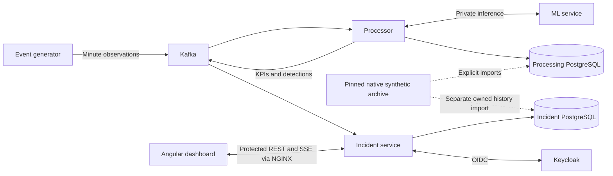

<p align="center">
  
</p>

# TraceLink

Telecom service monitoring, anomaly detection and incident investigation using
synthetic VoLTE/SMS telemetry and versioned Trace Link history.

[](https://github.com/denis2224-dev/Telecom-Anomaly-Detection/actions/workflows/dashboard.yml)
[](https://github.com/denis2224-dev/Telecom-Anomaly-Detection/actions/workflows/incident-service.yml)
[](https://github.com/denis2224-dev/Telecom-Anomaly-Detection/actions/workflows/integration.yml)

Developed as a UTM internship project at Orange Systems Moldova. This repository
does not imply organizational endorsement. Redistribution licensing is pending
owner approval; see [licensing](#licensing).

## Capabilities and scope

- Deterministic synthetic observation generation, continuous service telemetry
  and replayable scenarios.
- Durable Kafka ingestion, UTC-minute VoLTE/SMS KPIs, deterministic detection
  rules, optional private ML enrichment and ordered incident evidence.
- Native five-minute Trace Link archive import and versioned history, primitive
  metric aggregation, exact CSV exports and explicit missing/stale states.
- Protected Angular investigation, Keycloak sign-in, analyst workflow, private
  notification history and REST/SSE reconciliation.
- Ten approved Trace Link cities and twelve links, with independently declared
  directions. Missing reverse measurements remain unavailable.

Implementation and historical verification are recorded in the
[completion record](docs/evidence/trace-link-completion-status.md).
Full release acceptance remains pending. A historical import does not authorize
live catalogue or new-domain delivery activation; browser push is disabled by
default. See [current limitations](#current-limitations).

## Architecture



The service stream uses **60-second** windows. The pinned `trace-link-md-30d-v1`
archive retains **300-second** native history and original source provenance;
one-minute live synthetic telemetry is a separate dataset. Database migrations,
frozen evidence and model manifests are compatibility and verification inputs.

## Prerequisites

| Tool | Supported project configuration |
| --- | --- |
| Java | JDK 21; Maven 3.9.16 is provided through the wrappers. |
| Python | 3.13; CI pins 3.13.9 for packaged-model verification. |
| Node.js | 24 recommended; exact supported ranges are in [package.json](apps/dashboard/package.json). |
| Docker | Docker Desktop on Windows/macOS, or Docker Engine with Compose v2 on Linux. |
| Shell | Bash for project lifecycle scripts; Git Bash on Windows. |

## Quick start

Run commands from the repository root. For a **new local installation**, follow
the [local development runbook](docs/runbooks/local-dev.md) to generate a private
`.env`, add the `telecom.test` hosts entry and prepare Docker. Reuse existing
credentials and volumes when an installation already exists.

```bash
npm --prefix apps/dashboard ci
npm --prefix apps/dashboard run build
bash scripts/up --with-incident-service
bash scripts/verify
```

Open **http://telecom.test:8080/dashboard**. The managed startup runs the backend
inside Compose. Initial synthetic service-history bootstrap may take several
minutes. Startup performs provisioning and imports; it is an installation action,
not a read-only health check.

There is no default application account. Use the runbook's Keycloak user and
[local analyst provisioning](docs/runbooks/local-dev.md#provisioning-an-application-analyst)
steps. An enabled Keycloak user also needs an enabled local analyst profile.

For host backend development, use `bash scripts/up` and run
`./mvnw spring-boot:run` from `services/incident-service` in a second terminal.
Use one backend mode at a time. Windows PowerShell uses `npm.cmd` and
`.\mvnw.cmd`; run Bash lifecycle scripts in Git Bash.

## Development and validation

Create a Python virtual environment and activate it for your shell, then install
the pinned development and ML dependencies:

```bash
python -m venv .venv
# Bash on Linux/macOS: source .venv/bin/activate
# Git Bash on Windows: source .venv/Scripts/activate
python -m pip install -r requirements-dev.txt -r services/ml-service/requirements-ml.txt
python scripts/check-contracts.py
python -m unittest discover -s tests -v
python -m unittest discover -s services/ml-service/tests -v
./mvnw -pl services/event-generator,services/processor -am verify
./mvnw -pl services/streaming-support -am install -DskipTests
./mvnw -f services/incident-service/pom.xml verify
```

The incident service has a separate Maven build. PostgreSQL/Kafka integration
tests require a working Docker daemon; skipped or unavailable tests do not prove
connected acceptance. See the [streaming runbook](docs/runbooks/streaming.md).

```bash
npm --prefix apps/dashboard run check:branding
npm --prefix apps/dashboard test
npm --prefix apps/dashboard run build
npm --prefix apps/dashboard run check:fixtures
cd apps/dashboard
npx playwright install chromium firefox webkit
npm run test:e2e -- --workers=2
```

The default browser suite starts a local dashboard server and includes controlled
API tests. Tests requiring real credentials or a connected stack have additional
requirements; see the [frontend acceptance record](docs/evidence/final-ui-signoff.md).
CI definitions under [.github/workflows](.github/workflows) are authoritative for
their verification matrix.

For UI work, `npm --prefix apps/dashboard start` runs the development server;
`npm --prefix apps/dashboard run start:fixtures` opens the synthetic preview.
Keep generated branding in sync using the [branding guide](docs/ux/branding.md).

## Repository map

| Path | Responsibility |
| --- | --- |
| `apps/dashboard/` | Angular dashboard, generated API types and browser tests. |
| `services/event-generator/` | Synthetic observations, scenarios and continuous service telemetry. |
| `services/processor/` | Durable ingestion, features, rules, ML enrichment and ordered outputs. |
| `services/incident-service/` | Authentication, persisted history, incident APIs and analyst workflow. |
| `services/ml-service/` | Private inference, packaged models and reproducible evaluation. |
| `services/streaming-support/` | Shared contract validation and Kafka readiness. |
| `contracts/` | Schemas, topology, policies, fixtures and dataset manifests. |
| `infra/`, `scripts/` | Local infrastructure, lifecycle and verification tools. |
| `tests/` | Python contracts, reference arithmetic and evaluation cases. |
| `docs/`, `tasks/` | Runbooks, architecture, user guidance and retained team evidence. |

## Configuration and data

[.env.example](.env.example) lists local configuration names and defaults; it
intentionally leaves passwords empty. The runbook generates credentials without
overwriting an existing `.env`. Keep secrets local and retain database volumes.
Optional Grafana settings are documented in the
[completion operations](docs/runbooks/trace-link-completion.md).

The full reference archive is supplied separately from Git. On the original
Windows workspace the integration pack is under
`C:/OrangeSystems/task/Trace_Link_Integration_Pack`; other machines must configure
their actual approved path. Follow the [Trace Link runbook](docs/runbooks/trace-link.md)
and [completion operations](docs/runbooks/trace-link-completion.md). Keep the full
archive, manifest and original source bytes. Bounded test fixtures cannot replace
the full reference input.

## Documentation

- [Developer task index](docs/tasks/README.md) and [team ownership](docs/architecture/owner-map.md)
- [Local setup](docs/runbooks/local-dev.md) and [streaming operations](docs/runbooks/streaming.md)
- [Observation contract](contracts/README.md) and [incident OpenAPI](contracts/openapi/incident-api.yaml)
- [Trace Link receiving contract](docs/architecture/trace-link-contract-resolution-v1.md)
- [Analyst guide](docs/user-guide/trace-link-analyst-guide.md)
- [Release manifest](docs/release/trace-link-release-manifest.json) and [verification record](docs/evidence/trace-link-completion-status.md)

## Current limitations

Full release gates are **not passed**. Remaining acceptance includes secure-origin
push or an approved flag-off decision, timed session and assistive-technology
reviews, new-domain live activation, coordinated capacity, receiving-machine
installation, complete rehearsals and real owner reviews. Archived results apply
to their recorded source and environment. Follow the completion record for the
remaining gates; do not infer deployment readiness from status badges.

## Contributors and licensing

Engineering ownership is recorded for Zavtoni Ion, Moroz Denis, Rusu Sergiu,
Nenita David and Bradu Stanislav in the [owner map](docs/architecture/owner-map.md).
Thanks to the project contributors and internship mentors.

### Licensing

MIT is the proposed project license, **pending copyright-holder and contributor /
internship authorization**. There is no approved repository-wide license grant.
The [license proposal](docs/mit-license-proposal.txt) records the unresolved holder,
approval requirements and third-party notice checks. Dependencies and bundled
tools retain their own licenses; preserve their notices in redistributed builds.
