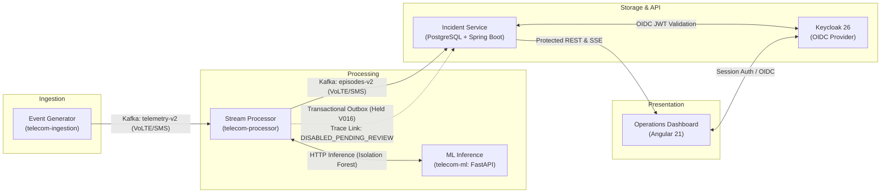

# System Architecture & Design Overview

This document provides a concise architectural reference for the Telecom Anomaly Detection system, outlining component topologies, windowing boundaries, delivery semantics, and security guarantees.

---

## 1. High-Level Pipeline Architecture

The system processes streaming telecommunications observations through a decoupled pipeline:

---

## 2. Windowing Resolutions & Domain Boundaries

The processing engine enforces strict domain-specific temporal window boundaries:

| Domain | Native Resolution | Window Semantics & Tolerances | Reference Contracts |
|---|---|---|---|
| **VoLTE Telemetry** | **60 seconds** | Aligned UTC minute buckets with 10-second lateness tolerance. Breached when Call Setup Success Rate (CSSR) drops > 1.0 percentage point below baseline under $\ge 100$ attempts. | [`contracts/policies/service-rules-v2.json`](../../contracts/policies/service-rules-v2.json) |
| **SMS Telemetry** | **60 seconds** | Aligned UTC minute buckets. Breached when SMSC Queue Depth $\ge 100$ with oldest age $> 60$s, or p95 delivery delay $> 20{,}000$ms ($> 3\times$ baseline). | [`contracts/policies/service-rules-v2.json`](../../contracts/policies/service-rules-v2.json) |
| **Trace Link Domain** | **300 seconds** (`NATIVE_300`) | Native 5-minute slots (`sourceResolutionSeconds: 300`). 60-second windows and live namespaces **never substitute** for native 300-second Trace Link projections. Explicit missing points; no duration rollup or synthetic translation. | [`contracts/policies/trace-link-domain-rules-v1.json`](../../contracts/policies/trace-link-domain-rules-v1.json) [`contracts/kpi/trace-link-domain-mapping-v1.json`](../../contracts/kpi/trace-link-domain-mapping-v1.json) |

---

## 3. Live Activation & Release Status

> [!IMPORTANT]
> **Trace Link Live Activation is NOT APPROVED (`DISABLED_PENDING_REVIEW`):**
> - **Kafka Delivery:** Production topic publishing for Trace Link remains disabled (`offered = acknowledged = 0`).
> - **Database Migrations:** Schema migration `V016` remains held in the transactional outbox table in `PENDING_REVIEW` state. No live connected receiver or downstream broker mutation is authorized.
> - **Runtime Isolation:** Scenarios execute against local deterministic fixtures and transactional rollback boundaries without mutating shared or production infrastructure.

---

## 4. Reliability & Fault-Tolerance Guarantees

1. **Fixed Window Immutability:** Observations belong to exactly one deterministic window. Observations arriving past the allowed lateness window are tagged as late or rejected without retroactively altering closed window states.
2. **Missing Data vs. Zero-Fill:** Missing metrics are recorded as absence or explicit `MISSING` quality. The system never fabricates healthy default metrics or zero-fills gaps.
3. **Episode State Machine:** An incident opens only after two consecutive breached windows. Recovery strictly requires three consecutive healthy windows. Indeterminate or gray-zone intervals remain in an `UNKNOWN` state without fabricating premature resolution.
4. **Idempotent Replay & Outbox:** Component outputs maintain deterministic correlation IDs. Replaying identical input bytes produces idempotent records. Trace Link outputs are staged in local transactional outbox tables before any potential publication.

---

## 5. Security & Access Model

- **Authentication:** Keycloak 26 OIDC identity provider manages realm credentials and token lifecycles.
- **Authorization:** Spring Security enforces role-based access controls (`ROLE_ANALYST`, `ROLE_SUPERVISOR`) on protected REST endpoints.
- **CSRF & Session Security:** State-mutating endpoints validate anti-CSRF tokens against secure HTTP-only cookies.
- **Network Isolation:** Microservice database and inference ports remain bound to the internal Docker Compose bridge network.

---

## 6. Authoritative Specifications

- [Trace Link Consumer Acceptance Specification](trace-link-consumer-acceptance-spec-v1.md)
- [Trace Link Primitive Projection v1](trace-link-projection-v1.md)
- [Trace Link Receiving Contract Resolution](trace-link-contract-resolution-v1.md)
- [Trace Link Migration Ledger](trace-link-migration-ledger.md)
- [Geographic Backend Contract](geography-backend-contract.md)
- [Team Ownership Map](owner-map.md)
