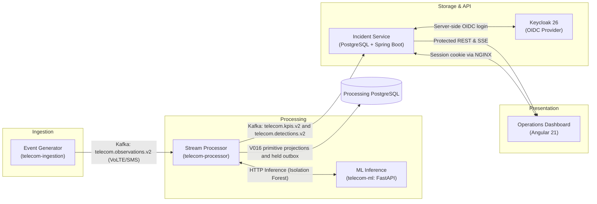

# System Architecture & Design Overview

This document provides a concise architectural reference for the Telecom Anomaly Detection system, outlining component topologies, windowing boundaries, delivery semantics, and security guarantees.

---

## 1. High-Level Pipeline Architecture

The system processes streaming telecommunications observations through a decoupled pipeline:

---

## 2. Windowing Resolutions & Domain Boundaries

The processing engine enforces strict domain-specific temporal window boundaries:

| Domain | Native Resolution | Window Semantics & Tolerances | Reference Contracts |
|---|---|---|---|
| **VoLTE Telemetry** | **60 seconds** | Aligned UTC minute buckets with 10-second lateness tolerance. Breached when Call Setup Success Rate (CSSR) drops > 1.0 percentage point below baseline under $\ge 100$ attempts. | [`contracts/policies/service-rules-v2.json`](../../contracts/policies/service-rules-v2.json) |
| **SMS Telemetry** | **60 seconds** | Aligned UTC minute buckets. Backlog requires fresh, aligned SMSC evidence, queue depth $\ge 100$ and oldest age $> 60$s. Delay requires complete evidence, at least 30 delivered samples, p95 $> 20{,}000$ms and $> 3\times$ a valid baseline. | [`contracts/policies/service-rules-v2.json`](../../contracts/policies/service-rules-v2.json) |
| **Trace Link Domain** | **300 seconds** (`NATIVE_300`) | Native 5-minute slots (`sourceResolutionSeconds: 300`). 60-second windows and live namespaces **never substitute** for native 300-second Trace Link projections. Explicit missing points; no duration rollup or synthetic translation. | [`contracts/policies/trace-link-domain-rules-v1.json`](../../contracts/policies/trace-link-domain-rules-v1.json) [`contracts/kpi/trace-link-domain-mapping-v1.json`](../../contracts/kpi/trace-link-domain-mapping-v1.json) |

---

## 3. Live Activation & Release Status

> [!IMPORTANT]
> **Trace Link Live Activation is NOT APPROVED (`DISABLED_PENDING_REVIEW`):**
> - **Kafka Delivery:** Trace Link detection is opt-in (`TRACE_LINK_ENABLED=false` by default). This documentation does not authorize enabling it or claim current runtime delivery counters.
> - **Database Migrations:** `V016__trace_link_domain_windows.sql` creates producer-owned immutable projections and an outbox whose rows remain `PENDING_REVIEW`. The migration itself is not an outbox row; that producer boundary has no publishing worker or agreed consumer topic.
> - **Runtime Isolation:** Offline rehearsals use deterministic fixtures. Connected scenario commands can persist data and publish observations when explicitly enabled; use disposable resources for verification and follow the [release preflight](trace-link-release-preflight.md).

---

## 4. Reliability & Fault-Tolerance Guarantees

1. **Fixed Window Immutability:** Observations belong to exactly one deterministic window. Observations arriving past the allowed lateness window are tagged as late or rejected without retroactively altering closed window states.
2. **Missing Data vs. Zero-Fill:** Missing metrics are recorded as absence or explicit `MISSING` quality. The system never fabricates healthy default metrics or zero-fills gaps.
3. **Service Episode State Machine:** The VoLTE/SMS service policy opens an episode after two consecutive breached windows and requires three consecutive healthy windows for recovery. Unknown evidence cannot establish recovery. Native Trace Link rules use their separately versioned policy; service thresholds do not substitute for it.
4. **Idempotent Replay & Outbox:** Component outputs maintain deterministic correlation IDs. Replaying identical input bytes produces idempotent records. Trace Link outputs are staged in local transactional outbox tables before any potential publication.

---

## 5. Security & Access Model

- **Authentication:** Keycloak 26 OIDC identity provider manages realm credentials and token lifecycles.
- **Authorization:** Spring Security requires `ANALYST`, `SUPERVISOR` or `ADMIN` for protected APIs, with additional endpoint/workflow restrictions.
- **CSRF & Session Security:** State-mutating endpoints validate session-backed CSRF tokens. The browser uses the backend session cookie; the backend performs OIDC login with PKCE. Local HTTP development does not establish secure-origin deployment acceptance.
- **Network Isolation:** Compose uses internal service networking and loopback-bound host ports for selected local tools. Consult [compose.yaml](../../compose.yaml) and the [local development runbook](../runbooks/local-dev.md) for the actual exposed ports.

---

## 6. Authoritative Specifications

- [Trace Link Consumer Acceptance Specification](trace-link-consumer-acceptance-spec-v1.md)
- [Trace Link Primitive Projection v1](trace-link-projection-v1.md)
- [Trace Link Receiving Contract Resolution](trace-link-contract-resolution-v1.md)
- [Trace Link Migration Ledger](trace-link-migration-ledger.md)
- [Geographic Backend Contract](geography-backend-contract.md)
- [Team Ownership Map](owner-map.md)
