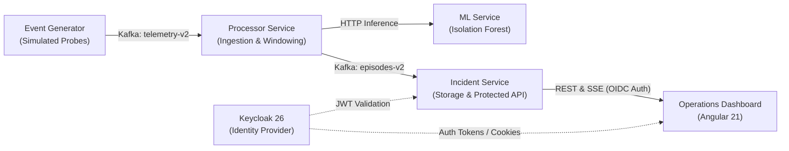

# System Architecture & Design Overview

This document describes the architectural foundation of **TraceLink**, detailing the data processing lifecycle, detection rules, resiliency patterns, and security guarantees.

---

## 1. High-Level Dataflow & Component Topology

TraceLink ingests, processes, and correlates streaming network observations through a decoupled pipeline:

---

## 2. Core Modules and Roles

### `services/event-generator`
- **Purpose:** Emits deterministic, schema-compliant synthetic observations (`TelecomObservationV2`) representing SERVICE (VoLTE, SMS) and NODE telemetry.
- **Scenario Injection:** Supports replayable scenarios (e.g. `VOLTE_IMS_OVERLOAD`, `SMS_QUEUE_DELAY`, `TELEMETRY_GAP`) driven by seeded deterministic pseudo-random generators.

### `services/streaming-support`
- **Purpose:** Shared Java library providing JSON schema validation, common contract models, and Kafka configuration helpers. Ensures producers and consumers maintain strict wire compatibility.

### `services/processor`
- **Window Aggregator:** Groups observations into 60-second aligned UTC windows with a 10-second lateness tolerance.
- **Rule Engine:** Evaluates deterministic policy thresholds defined in [`contracts/policies/service-rules-v2.json`](../../contracts/policies/service-rules-v2.json).
- **ML Integration:** Synchronously requests anomaly rankings from `services/ml-service` with bounded timeouts and fallbacks.
- **Transactional Outbox:** Stores finalized incident episodes in a local transactional outbox table before publishing to Kafka, ensuring zero message loss on broker downtime.

### `services/incident-service`
- **Persistence:** Stores incident episodes, timelines, and raw evidence in PostgreSQL using Flyway-managed schema migrations.
- **API Server:** Provides session-authenticated REST endpoints and Server-Sent Events (SSE) for live push updates.
- **Security:** Validates OAuth2/OIDC JWT tokens issued by Keycloak and enforces role-based access control (`ROLE_ANALYST`, `ROLE_SUPERVISOR`).

### `services/ml-service`
- **Inference Engine:** Serves scikit-learn Isolation Forest models over private FastAPI endpoints.
- **Evaluation & Benchmarking:** Evaluates candidate model packages against historical datasets with strict false-positive budgets.

### `apps/dashboard`
- **Single Page Application:** Modern Angular 21 interface presenting real-time KPI graphs, geographic health maps, and evidence timelines.
- **Live Updates:** Consumes SSE streams to dynamically update incident lifecycles without requiring browser refreshes.

---

## 3. Telemetry Domains & Service Assurance

| Domain | Key Metrics & Dimensions | Evaluation Semantics |
|---|---|---|
| **VoLTE** | Call Setup Success Rate (CSSR), SIP 503 response ratios, RRC delta, IMS CPU. | Breached when CSSR drops > 1.0 percentage point below baseline under >= 100 eligible attempts. |
| **SMS** | p95 Delivery Delay (ms), SMSC Queue Depth, Oldest Pending Age (s), Message Conservation. | Breached when queue depth >= 100 with age > 60s, or p95 delay > 20,000ms and > 3x baseline. |
| **Trace Link** | Transport utilization, Roaming registration success, Mobile Data DNS & Throughput. | Multi-domain synthetic telemetry with explicit source provenance and bounded capacity models. |

---

## 4. Reliability & Ingestion Guarantees

1. **Fixed Windowing:** All observations belong to exactly one 60-second window. Observations arriving late beyond the configured threshold are rejected or tagged as late input without retroactively mutating closed windows.
2. **Missing Data Semantics:** Missing metrics are recorded as absence or explicit `MISSING` quality. The system never fabricates healthy default values or zero-fill for missing telemetry.
3. **Episode State Machine:** An incident opens only after two consecutive breached windows. Recovery requires three consecutive healthy windows. Unconfirmed or gray-zone intervals keep the incident open under an `UNKNOWN` state without falsifying resolution.
4. **Idempotent Replay:** Every event and window contains a deterministic correlation ID. Replaying identical input bytes produces idempotent output without duplicate incident generation.

---

## 5. Security & Authentication Model

- **OIDC Identity Provider:** Keycloak manages users, credentials, and realm configurations. Container and database ports remain private to the internal Compose bridge.
- **Gateway Reverse Proxy:** NGINX handles SSL termination, routing, and header preservation.
- **CSRF Protection:** State-changing REST endpoints enforce anti-CSRF token verification on session cookies.

---

## 6. Detailed Architectural Specifications

- [Team Ownership Map](owner-map.md)
- [Geographic Backend Contract](geography-backend-contract.md)
- [Trace Link Consumer Acceptance Specification](trace-link-consumer-acceptance-spec-v1.md)
- [Trace Link Primitive Projection v1](trace-link-projection-v1.md)
- [Trace Link Receiving Contract Resolution](trace-link-contract-resolution-v1.md)
- [Trace Link Migration Reservations](trace-link-migration-ledger.md)
