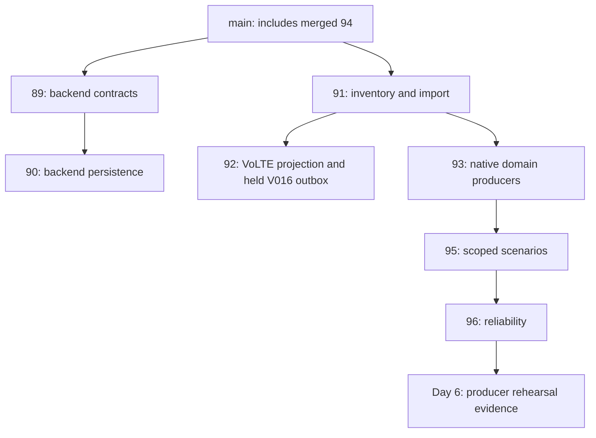

# Trace Link producer release preflight

Executed **12 October 2026, Europe/Chisinau**, for the 15 October milestone.
Producer decision: **PRODUCER_READY_FOR_REVIEW**, subject to the recorded checks.
Overall release: **BLOCKED**. This is a producer release fragment, not the shared
team release manifest or a receiving-owner approval.

## Reviewed dependency graph

Main is `bccfd01d20373d71cd6b51f7c102ebde45c884ff`, which includes merged #94
offline seasonal baseline, domain rules, cause controls and recovery policies.
Exact heads, bases, CI jobs and reviews are archived under
[`assets/trace-link-day6/preflight`](../evidence/assets/trace-link-day6/preflight).
All eight PR heads had six successful CI jobs at inspection. #89/#90 are open
and non-draft; #91/#92/#93/#95/#96 are Draft; #94 is merged. No approval was
recorded. #94's sole COMMENTED review reports an automated review quota limit.
All eight review-thread queries returned zero threads, with no additional page.



Arrows show declared PR bases; divergence from current main still requires
reconciliation. Git ancestry independently confirms that **#92 is absent from
#93, #95 and #96**. Its V016 implementation is therefore exercised in the Day 6
reactor only through the explicit frozen-SQL disposable compatibility test.

## PR #91 conflict investigation

Non-destructive `git merge-tree --write-tree` and a detached disposable worktree
both reproduce exactly two genuine content conflicts:

| File and hunk | Main contribution | #91 contribution | Proposed resolution |
| --- | --- | --- | --- |
| `.gitattributes`, after Day 1 evidence rules, around line 23 | Preserve receiving-reproduction JSON raw bytes | LF native-slice, dataset-manifest and import-evidence rules | Retain both complete blocks |
| `scripts/check-contracts.py`, after fixture validation, around line 118 | Execute Day 2 and seasonal baseline validators | Execute domain inventory/native validators | Retain all three validator calls/imports |
| `services/processor/pom.xml` | Package `evidence/**` and `kpi/**` contract resources | Include `TraceLinkDatasetBootstrapIT` in Surefire | Automatically clean merge; retain both, no manual hunk required |

Conflicted tree: `8489c1da5cb06739252ccce8b7724d0e9828964c`.
Resolved tree: `ab1b1d46af378288475f7764f629719897521593`.
The [resolution patch](../evidence/assets/trace-link-day6/preflight/pr91-resolution.patch)
removes only conflict markers and retains both sides. It applies to the conflicted
working files generated with main as ours and #91 as theirs. Reverse-apply check
passed against the resolved worktree. Neither existing branch was modified.

The candidate passed contracts, **137 Python tests**, and a focused Java reactor:
**52 reported, 51 passed, one explicit archive-input skip, zero failures/errors**.
The Java selection includes seasonal baseline, domain rules, strict inputs,
offline integration, cause controls, mapped transport, recovery, domain validator
and PostgreSQL importer tests. The skipped archive test was not selected with its
external archive root in this candidate; the producer reactor separately runs it
with the approved opt-in input. Main's policy/baseline/detection/cause source and
contracts are byte-identical in the candidate Git tree.

Reproduction, in a new detached worktree only:

```powershell
git worktree add --detach ../trace-link-resolution-review bccfd01d20373d71cd6b51f7c102ebde45c884ff
Set-Location ../trace-link-resolution-review
git merge --no-commit --no-ff 1e67e61ce3f2c46f26818b42c17fc3d50481aae4
# The merge must stop with the two conflicts above.
git apply ../ion-tracelink-day6-rehearsal/docs/evidence/assets/trace-link-day6/preflight/pr91-resolution.patch
git add .gitattributes scripts/check-contracts.py
git diff --cached --check
python scripts/check-contracts.py
python -m unittest discover -s tests -v
./mvnw.cmd -B -ntp -pl services/processor -am '-Dtest=TraceLinkSeasonalBaselineTest,TraceLinkDomainRulesTest,TraceLinkInputsTest,TraceLinkOfflineIntegrationTest,TraceLinkRecoveryPolicyTest,TraceLinkServiceTransportTest,TraceLinkCausePolicyTest,DomainObservationValidatorTest,TraceLinkDatasetBootstrapIT' '-Dsurefire.failIfNoSpecifiedTests=false' verify
```

## Parallel-child compatibility and proposed merge sequence

An additional #96/#92 merge simulation finds conflicts in `.gitattributes`,
`scripts/check-contracts.py`, and `services/processor/README.md`. Each contains
independent additive blocks: retain producer/scenario/reliability rules **and**
projection rules, run both producer and projection validators, and document both
separate jobs. The importer test source merges automatically. This second union
was **not built or accepted**; its conflict evidence is archived. Audit migration
discovery, runtime grants, table inventory, test initialization and profile flags
when V016 becomes an in-tree migration; the external frozen-SQL test is not proof
of that combined branch. Do not rename or edit frozen V016.

Recommended sequence, for owners to review and execute later:

1. Keep already merged #94 and its policy work intact. Review the #91 resolution
   patch, rerun its checks on the then-current main, and obtain merge authorization.
2. Merge #91 only after that review. Reconcile #92 and #93 as parallel children;
   #92 must be integrated explicitly if its held projection is required.
3. Review the additive #92/#93 union independently, keeping delivery held and
   schema/resource/grant tests valid. Then integrate #95, #96 and Day 6 in order,
   refreshing base references deliberately after each parent merge.
4. Review #89 then #90 as Denis's separate chain. Version and approve producer
   mappings before any consumer wiring. Their branches are untouched here.
5. Resolve the interface proposals below, build one shared release identity, and
   execute connected acceptance before enabling new-domain delivery.

No merge, rebase, force push, topic creation or outbox release was executed.

## Producer-to-detector compatibility

The [negative Java probe](../evidence/assets/trace-link-day6/compatibility-probe.json)
uses unchanged main classes: an existing 300-second fixture validates, the raw
producer payload fails strict evidence validation, and an otherwise valid
context with a 60-second window fails with `Expected aligned five-minute window`.
Main's existing offline fixtures were executed successfully; those results are
archived separately from producer measurements. They do not demonstrate detection
or incidents from the one-minute rehearsals.

After building the proposed merge candidate, reproduce the rejection probe:

```powershell
python scripts/probe-trace-link-compatibility.py --merged-worktree '<resolved-main-and-91-worktree>' --measurements '<rehearsal-output>/run-1/mobile-data-fault.jsonl' --output '<new-probe-directory>' --java-home '<Java-21-home>'
```

The probe reads the existing test fixture from its explicit file path; it does
not assume test-only fixtures are packaged into the production JAR.

| Dimension | Producer evidence | Merged detector contract | Status / narrow handoff |
| --- | --- | --- | --- |
| Envelope | `trace-link-domain-window-v1`; flat event/scope/window fields, measured primitives | Numeric evidence schema v1 plus `trace-link-evaluation-v1` context, typed primitives and required calculated evidence fields | PENDING_REVIEW: explicit versioned mapping; raw shapes reject |
| Dataset/source | Live synthetic dataset and seed-qualified generator; historical native dataset remains separate | Evidence provenance fixes `trace-link-md-30d-v1`; origin is HAND_CALCULATED, REFERENCE_CSV or REFERENCE_ENGINE | BLOCKED: add a separately reviewed live synthetic provenance contract; never relabel as archive or hand-calculated |
| Scope | Link id plus direction; ROAMING_PROCEDURE partner/country/direction/REGISTRATION; CITY_SERVICE lowercase city plus LTE/DNS | Link id includes `:direction` and uppercase endpoint city IDs; PARTNER_DIRECTION; CITY uppercase city | PENDING_REVIEW: explicit catalogue-backed translation preserving every dimension; no string-only alias |
| Domain/metrics | TRANSPORT, ROAMING, MOBILE_DATA and six dictionary metric IDs | Same domains and shared IDs, plus additional loss/RTT/service inputs | Shared names do not imply wire compatibility; no voice.success_rate/volte.setup.success alias |
| Duration | Live 60s; native 300s; separate source/dataset identities | Context requires aligned 300s windows | BLOCKED: propose `trace-link-live-evaluation-v1` with reviewed minute timing; no upsampling or forced five-minute context |
| Quality/coverage | VALID/MISSING/INSUFFICIENT_EVIDENCE; scalar quality, separate coverage; native unknown source metadata retained | Structured quality/reason, freshness and strict actual/null arithmetic | PENDING_REVIEW: preserve unknown, stale, zero population and explicit null reasons; historical eligibility is not observed freshness |
| Timestamps | UTC half-open window; emittedAt=end; generated logical time | UTC window, generatedAt, evaluatedAt, freshness.asOf, observedAt and recomputed source age | PENDING_REVIEW: producer emission does not establish ingestion time or source freshness |
| Policies | `trace-link-kpi-v1`, catalogue `trace-link-geography-v2`, topology `trace-link-links-v1` | Offline rules `trace-link-domain-rules-v1`, baseline `trace-link-seasonal-v1` / `trace-link-baseline-policy-v1`, cause `trace-link-cause-v1`; reference topology `trace-link-md-topology-v1` | PENDING_REVIEW: explicit metric/rule/baseline/cause version binding and authoritative topology mapping |
| Provenance | Stable event ID binds source, seed, scope, metric, duration, versions; synthetic=true | Evidence/measurement IDs, sourceChecksum, observedRevision, dependency provenance | PENDING_REVIEW: retain original payload hash/event ID, never derive provenance from expected labels |
| Baselines | No runtime baseline or training claims in measured JSONL | Lookup must match metric/scope/unit/topology, training cutoff and policy; static fallback is explicit | PENDING_REVIEW: fit a compatible live baseline or explicitly version demonstration fallback |
| Availability: Transport | Traffic, effective capacity and utilization only | Utilization is an overload candidate; loss/RTT or mapped measured service evidence qualify supported symptoms/causes | No packet loss, RTT, LAG failure or customer outage may be inferred from utilization |
| Availability: Roaming | Independent registration attempts/successes and healthy opposite direction | Registration rule and opposite-direction cause admission exist offline | Numerics are comparable; interface, baseline and duration gates still block live evaluation |
| Availability: LTE | DNS and independent EPS bearer activation populations | Separate DNS/activation rules exist offline; historical activation reference population is unavailable | Live synthetic activation must retain its own provenance; never substitute historical session counts |
| Evaluation separation | No scenario type, runId, truth, expected transition or future outcome in measured JSONL | Strict evidence/context allowlists and separate cause controls | VERIFIED for exported producer artifacts; connected admission remains NOT_VERIFIED |
| Recovery | Three measured recovery slots; explicit missing recovery slots and interrupted history | Policy recovers after three consecutive eligible healthy five-minute results; UNKNOWN does not recover | Minute producer schedule cannot prove a five-minute incident lifecycle; connected recovery BLOCKED |

Sergiu should review an additive live evidence/context version and its minute
policy, with fixture examples and no changes to merged offline policy behavior.
Denis should review exact payload/projection mapping, quality lengths/enums,
deduplication keys and read-model provenance. #92's existing
`trace-link-consumer-handoff-v1.md` remains the separate VoLTE projection proposal.
No adapter, detector worker or consumer was invented in this delivery.

## Connected execution checklist for Denis and Stanislav

Status: **BLOCKED** until approved topics, compatible producer/consumer commands,
disposable deployment, runtime roles and one shared release manifest are supplied.
The missing connected harness is a concrete prerequisite; local legacy test
commands cannot execute these new-domain acceptance cases. For each case record
the actual command, source SHA/configuration, fault instant, event/payload hashes,
ACK/offset state, SQL projection count/hash, backlog/lag and recovery interval.

| Ordered case | Execution / required assertion | Owner |
| --- | --- | --- |
| 1. Preparation | Verify exact shared manifest, image digests, migration/grant state, dedicated topic/key/partition approval, disabled auto-creation, resource limits and recoverable disposable backup | Stanislav + Denis |
| 2. Send before ACK | In the approved publisher inject send failure before broker acceptance; retain one logical offer and the original bytes for retry | Stanislav |
| 3. Uncertain ACK | Lose sender ACK after broker acceptance; resend identical event/hash; consumer persists one logical projection | Stanislav + Denis |
| 4. ACK then mark failure | Fail the durable publication mark after ACK; retry original bytes; held V016 stays held unless separately authorized | Denis + Stanislav |
| 5. Consumer commit boundary | Crash before commit then after commit/before offset ACK; retry preserves projection identity, counters and immutable history | Denis |
| 6. Conflicting duplicate | Same event/natural key with changed payload fails explicitly; identical duplicate does not inflate aggregates | Denis |
| 7. Reads/security | Use the normal login/session flow; verify authenticated inventory/series/CSV/history reads, unauthenticated rejection, role isolation and CSRF on mutations; record sanitized status/body hashes only | Denis |
| 8. Capacity and lag | Execute scripts/load-profile.json: 120s warmup, 900s steady state, owner-bounded burst; compare offered/ACK/persisted/finalized/published counts on matching intervals, CPU/RAM and resource ceilings | Stanislav |
| 9. Dependency recovery | Interrupt dedicated PostgreSQL/Kafka separately, retain retryable work, restore and measure lag/backlog drain; missing windows stay unknown until actual valid measurements | Stanislav + Denis |
| 10. API/UI/Grafana | Reconcile exact same-SHA window/event/detection/episode IDs and read-only Grafana values, real UI/login and notification transitions | Denis, David, Sergiu, Stanislav |
| 11. Backup/restore and restart | Restore all owned DBs/configuration to a disposable target, reconcile receipts/outboxes/import progress/history and verify safe restart and replay | Stanislav + Denis |
| 12. Rehearsals/signatures | Run two connected release rehearsals and obtain five actual owner reproductions on one authoritative manifest | All owners |

The existing `ReplayIT`, `FinalizerRaceIT`, `DependencyOutageIT` and retention
tests provide executable **legacy** examples and pass in the producer reactor.
They are not substituted for the missing new-domain connected harness.

Backup prerequisites inspected: PostgreSQL 16.4 image and `pg_dump`/`pg_restore`
binaries exist; database ownership/runtime separation and immutable checkpoint
rules are documented/tested. Compose initializes legacy topics with auto-create
disabled; it supplies no approved new-domain topic or measured capacity limits.
There is no verified Day 6 backup artifact, restore run, shared release image set,
three-database restore consistency record or authenticated post-restore smoke.
Backup/restore and deployment acceptance remain **NOT_VERIFIED / BLOCKED**.

## Receiving-owner record

| Receiver | Reviewable input and concrete reproduction | Actual receiver result |
| --- | --- | --- |
| Sergiu | Both run directories, independent per-minute primitives and separate summaries; main offline policy outputs and exact incompatibilities above | NOT_VERIFIED; PENDING_REVIEW |
| Denis | Dataset/source/configuration hashes, measured payloads, stable IDs, quality semantics and connected cases 2-7 | NOT_VERIFIED; PENDING_REVIEW |
| David | Five executable types, thirteen unsupported definitions, exact logical schedule and STOPPED/INTERRUPTED/missing wording in demo script | NOT_VERIFIED; PENDING_REVIEW |
| Stanislav | Frozen archive/V016 hashes, reactor failure/restart/retention evidence, capacity profile, topic/role/deployment and backup prerequisites | NOT_VERIFIED; BLOCKED connected execution |

No messages or approval requests were sent to teammates. No receiving owner has
reproduced this Day 6 package. Five-owner sign-off has not been achieved.
