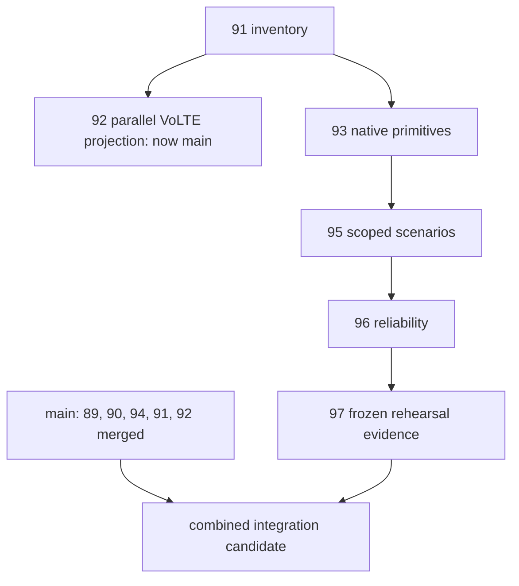

# Trace Link integration candidate

Executed 12 October 2026, Europe/Chisinau. This is an integration verification
record, not a receiving-owner signature or authorization to activate delivery.
Verdict: **INTEGRATION_CANDIDATE_VERIFIED**. Overall release: **BLOCKED**.
The final verification manifest and command logs are under
[`assets/trace-link-integration-20261012`](assets/trace-link-integration-20261012).

## Source identity and current dependency graph

Initial main was `47a2c9236e8ac82351b7fa62ec2264cc8df103c2`, already containing
#89/#90 and the Day 2 detector. During this audit the repository independently
merged #91 at `71da1e0` and #92 at
`ae9a53626ac7ee62efec40a19ebb20c6e2cf7049`. The integration agent did not merge
any PR or change an owner branch. An isolated merge records that upstream
ancestry without changing one byte of the candidate tree.

| Input | Exact head | Current disposition |
| --- | --- | --- |
| #89 backend contracts | fec8905d7ba5563a8ebfe0aa541c16b1cb93b75b | Merged |
| #90 backend persistence | 923a9f009ce402b84cc26882466e7c2e3989a136 | Merged |
| #91 inventory/import | 5daccd7ba207ffcfea0d21e89151a79154586fba | Merged during audit |
| #92 canonical native VoLTE projection | b987aa809101eedc1d40d52c95dff94a1e9e27b8 | Merged during audit; delivery remains held |
| #93 native new-domain primitives | e9a79c1f2fa2c5a59b366336e74b4e3b2b94bbb8 | Draft producer-chain root |
| #95 scoped scenarios | e3d0a41da141f2a836edbd35258ba878efc335dd | Draft, child of #93 |
| #96 reliability | 8fb0596b415b4fef137b29b38774948d3112c1a0 | Draft, child of #95 |
| #97 producer rehearsal package | 5d2b6d102ac2914ede7bfc812ad51ebb3b20dc2c | Draft, child of #96 |

#92 was a parallel child of #91; it is not hidden in #93/#95/#96/#97 ancestry.
It was deliberately merged into the combined candidate before main acquired it.
The historical and refreshed GitHub snapshots, workflow jobs, comments/reviews
and exact main-only/head-only counts are archived. A PR's declared base is
separate from its actual Git ancestry; owner bases were not retargeted here.

Producer-stack-only candidate: source
`fc35261dfe631839c721326e8b46baae659de21b`, tree
`307df407efd7ad19a4bae8660c3b610e608d146f`, detached worktree
`C:/OrangeSystems/Program/trace-link-combined-20261012` (its directory name does
not imply V016 is present).

Combined merge snapshot: `e85a81660aeff3ebae71150a6361084dd11191b2`, tree
`b4f759b5fb79e707b06d8ea7efa59a1b1eb3c715`.
Verification-tool snapshot with updated main ancestry:
`46c9b50db6d11f0588b2ab0aa9036b53d5b19fb9`, tree
`93242ee84a92a9d9a98e7caba68866674f6ea354`, isolated branch
`integration/trace-link-readiness-20261012` in
`C:/OrangeSystems/Program/trace-link-integration-20261012`.
The latter tree is exactly the earlier `ac1c002...` tool snapshot tree.
Java production/test inputs, contracts and applied SQL are unchanged between
the combined merge snapshot and that verification snapshot; the added helper
and proposal do not alter runtime behavior. The final verified tool/build snapshot
is `f572ebd27c71cb809eb43fa51f07f40740ae181c`, tree
`83b8bb260ceba844fdbcee388c275b2ba15dc4ed`. It adds a frozen-V016 LF attribute
(`f453126`) and corrects the helper's gap-example selection (`f572ebd`).
Java, SQL Git blobs, contracts and tests still match the combined merge snapshot.
Subsequent publication changes package documentation, evidence and its raw-byte
whitespace attributes; the final PR
head identifies that commit.

## Conflict resolution and preservation

1. The original bccfd01/main + 1e67e61/#91 conflict reproduces in a new detached
   worktree in exactly `.gitattributes` and `scripts/check-contracts.py`.
   The smallest union reverses cleanly against the archived resolution patch;
   its resolved tree is exactly `ab1b1d46af378288475f7764f629719897521593`.
   Fresh contracts and 137 Python tests pass with one PowerShell-runtime skip.
2. Refreshed #91 already includes initial current main; that merge is clean.
   Applying the old patch blindly to the new head would be incorrect.
3. Adding #93 to the refreshed inventory/main candidate conflicts in
   `.gitattributes` and `scripts/check-contracts.py`. Both detector/seasonal
   validators and producer validators are retained in commit `2c4d313`.
   #95/#96/#97 then merge cleanly.
4. Adding refreshed parallel #92 conflicts only in
   `services/processor/README.md`; union retains the separate native producer,
   reliability and held VoLTE projection instructions. `.gitattributes`,
   `scripts/check-contracts.py`, POM and importer test initialization merge
   automatically. Commit `e85a816` records that resolution.
5. A fresh direct simulation of current main ae9a536 + frozen #97 still finds
   three conflicts: attributes, contract checker and processor README. The
   combined branch resolves them; no unmerged entries remain in its index.

`producer-resolution.patch` and `parallel-projection-resolution.patch` archive
the actual merge resolutions. `source-changed-files.txt` lists the 219 paths
changed from ae9a536 to the verification snapshot; `publication-changed-files.txt`
lists the complete delivered diff. Main's detector/baseline/cause/recovery and
the entire incident-service subtree are byte-identical to the refreshed base.
The processor POM retains production evidence/KPI resources and importer plus
projection Surefire inclusions. Frozen V016 bytes were not edited.

The pre-existing primary checkout remains at `0eb9b5b...` on
`feature/volte-sms-service-assurance`, with its original dirty and untracked
work retained. No existing worktree was reset, cleaned, rebased or removed;
no stash, database, demo account or data volume was reset. New test databases
and brokers are disposable Testcontainers instances. Native source identity,
legacy VoLTE/SMS semantics and scenario replay protection remain regression gates.

## Verification and combined V016

Exact final counts, individual skipped tests, commands, separate failed
invocations, source/output hashes and full compressed logs are in
`verification.json` and the report ZIP. Results from overlapping focused checks
are not added to the full-suite totals.

| Independent invocation | Reported | Passed | Skipped | Failures / errors |
| --- | ---: | ---: | ---: | ---: |
| Full combined Java reactor (26m36s) | 1307 | 1302 | 5 | 0 / 0 |
| Incident-service full verification | 243 | 242 | 1 | 0 / 0 |
| Separate full native VoLTE projection (15m16s) | 1 | 1 | 0 | 0 / 0 |
| Producer-stack-only focused Java | 53 | 52 | 1 | 0 / 0 |
| Combined repository Python | 159 | 158 | 1 | 0 / 0 |
| Producer-stack-only Python | 152 | 151 | 1 | 0 / 0 |
| Historical #91 resolution Python | 137 | 136 | 1 | 0 / 0 |
| ML with pinned repository environment | 64 | 64 | 0 | 0 / 0 |
| Final LF V016 fresh/upgrade checks | 2 | 2 | 0 | 0 / 0 |

The full reactor modules report 120 streaming-support, 138 event-generator and
1049 processor cases. Five processor skips are three packaged ML HTTP checks
without `ML_SERVICE_URL`, SMS shadow replay without `SMS_SHADOW_REPLAY_DIR`,
and opt-in full projection without `traceLink.projectionReferenceRoot`. The last
case passes separately with the archive explicitly selected. Incident-service
skips optional SMS shadow replay. Producer-only focused Java skips an unselected
archive input. Each Python invocation skips the regression requiring absent
`pwsh`. These are skipped checks, not passing acceptance gates.

The full reactor began at `e85a816`; the separate full projection uses `ac1c002`.
Their committed runtime, migration, contract and test inputs are byte-identical
to `f572ebd`. The raw packaged check nevertheless exposed Windows CRLF conversion
of V016: Git's approved LF SHA was unchanged, while the JAR contained SHA
`75f3a07f3a193b80b970a6a311a109b14a69fe36e89a65813e03489e6b5fe21f`.
An explicit LF attribute fixes future checkout/build portability without editing
the SQL Git blob. Repackaging, two fresh migration/grant checks and the full
packaged verifier pass with approved SHA
`bf9bb63333a69c199f96ba2a380b394be3a716d6521b19dd9143d7ebebc7e848`.
This is an isolated build fix; it is not a migration rewrite or instruction to
repair/rebaseline any existing database.

The actual combined V016 checks cover fresh sixteen-migration discovery,
V015-to-V016 upgrade, schema/column/grant equivalence, importer initialization,
immutable projection/outbox rows, runtime DDL/mutation/cross-database denial,
the unchanged one-minute legacy feature-outbox constraint, exact/concurrent
retry, conflicting payload/natural key, transaction rollback, actual database
loss/restoration, source preservation, and isolated tool startup without live
workers or Kafka. The prior external-SQL compatibility test also passes with
the combined classpath; no duplicate-discovery defect was reproduced and no
test or migration was weakened to force acceptance.

The packaged verifier checks all sixteen migrations and the frozen V016 hash,
processor evidence/detection/KPI/baseline resources, nested streaming-support
inventory/topology/dataset/observation resources, absence of test-only production
fixtures, and mutually exclusive entrypoint modes failing before live startup.
It extracts eight byte-preserved measured examples and validates schema,
truth exclusion and deterministic producer identity.

All 124 archived Day 6 artifacts, both independent rehearsal manifests, source
pins and demo configuration hash verify unchanged. All 29 frozen inputs and
54 four-language arithmetic goldens verify. No full Day 6 rehearsal was repeated;
a bounded packaged CLI compilation/replay checks eight windows/24 observations.
The separate full-native projection verifies 362880 native rows, 8640 projection
rows, 8640 held outbox rows, 8640 native 5m buckets and 121 UTC 6h buckets,
independent SQL parity and exact retry. Fresh legacy VoLTE/SMS payload parity
passes 7/12 cases and persisted geographic parity passes 90/90 with zero difference.

The global Python ML attempts are retained as FAIL (one assertion failure and
nine errors each), caused by installed NumPy/joblib/FastAPI differing from the
packaged-model environment. The existing repository environment matches the
manifest and passes all 64 ML tests without changing models or validation.
One unsupported arithmetic CLI flag and one SQL-export isolation-label rejection
are retained as failed invocations; corrected documented isolated exports pass.
The first packaged-helper invocation fails on the real CRLF mismatch; the next
exposes an incorrect 09:02 gap selection in the new helper. The helper is corrected
to the unchanged separate schedule's actual 09:18 missing slot and passes.
An unquoted PowerShell Maven-property invocation also fails; the quoted cached
command passes. All failed invocation logs remain separate from passing checks.
Graphify's final graph rebuild reports 10682 nodes/27010 edges/631 communities,
but exits 1; that tooling status is separate from application test results.

## Contract decisions and receiving acceptance

Producer-to-detector: **BLOCKED / PENDING_REVIEW**.
Fresh unchanged offline tests pass; a real producer wire observation is rejected,
and a 60-second context rejects with `Expected aligned five-minute window`.
The [versioned live proposal](../architecture/trace-link-live-evaluation-v1.md)
includes actual fixtures, explicit source/scope/topology authority, quality,
coverage, baseline, timestamps, identity and missing-data decisions. There is
no silent duration/metric alias, policy rewrite or fabricated adapter authority.

Producer-to-consumer: **INCOMPATIBLE / PENDING_REVIEW**.
Current main still exposes voice.success_rate / trace-link-md-policy-v1, whereas
#92 emits volte.setup.success / trace-link-kpi-v1. V006's quality VARCHAR(16)
and enum reject INSUFFICIENT_EVIDENCE. Scope/procedure preservation, nullable
source metadata, provenance, topology validation, deduplication and query-edge
semantics require owner decisions. #93's eleven native metrics and six live
metrics have different shapes and qualifications. The
[consumer acceptance specification](../architecture/trace-link-consumer-acceptance-spec-v1.md)
defines the isolated fixture, additive migration, exact/conflicting retry,
role and authenticated-read cases. No Denis-owned code or migration was changed.

| Owner | Independently executable package | Genuine receiving result |
| --- | --- | --- |
| Ion | Frozen producer release fragment, source pins and combined regression evidence | NOT_VERIFIED; agent evidence is not a personal signature |
| Sergiu | Existing offline positives, live rejection probe, UNKNOWN/recovery/cause controls and live interface proposal | PENDING_REVIEW / NOT_VERIFIED |
| Denis | Exact current consumer comparison, separate #92 agreement, #93 metric matrix and isolated acceptance specification | PENDING_REVIEW / NOT_VERIFIED |
| David | Five supported types, bounded CLI, independent controls, scheduler/checkpoint statuses and gaps | NOT_VERIFIED; connected API/UI blocked |
| Stanislav | Migrations/grants, archive/hash/retry/outage evidence, capacity profile and deployment/restore prerequisites | NOT_VERIFIED; connected operations blocked |

The [receiving checklist](../runbooks/trace-link-receiving-integration.md) gives
the exact source, inputs, executable commands, expected results and output paths
for each owner. Missing live publishers/consumers/configuration are stated as
blockers rather than replaced by invented commands or signatures. GitHub
inspection found no human approval/reproduction comments on the audited chain;
#94's sole COMMENTED bot review reports a quota limit and is not approval.
External PR merges alone do not supply five same-configuration sign-offs.

## CI, merge order and release blockers

The refreshed frozen heads #91/#92/#93/#95/#96/#97 each have four completed
successful workflows and six completed successful jobs. Job IDs, steps, exact
head SHAs and observation timestamps are retained in `ci-jobs-final.json`.
No in-progress workflow is counted as passed. #93 remains conflicting against
its declared base; #95/#96/#97 are mergeable against their own stacked bases,
which does not make #97 mergeable directly into main. #91/#92 are now merged;
GitHub's mergeable=false on those closed PRs is not a remaining candidate conflict.
The separate combined Draft PR's new CI must be checked independently after
publication; parent CI is not evidence that its jobs have run.

Recommended owner-controlled sequence: #91/#92 and #89/#90 are now already
merged; review the resolved #93-on-main union, then #95, #96 and #97 in order,
or review the separate combined Draft candidate as an explicit integration
alternative. Refresh refs and rerun affected checks at each owner-controlled
merge. Do not count the parallel VoLTE projection as new-domain delivery.

Overall release remains **BLOCKED** on approved minute detector evidence/policy
and baseline authority; consumer mappings/additive read model; actual connected
producer → detector → consumer delivery and ACK/restart cases; authenticated
API/UI and notification transitions; read-only Grafana verification; dedicated
topics/roles, shared image/configuration identity and resource limits; the
120s/900s/bounded-burst/recovery capacity run; consistent backup/restore and
authenticated post-restore smoke; two connected rehearsals and five genuine
owner reproductions/signatures. The capacity target/burst/recovery limits are
still unset. A stopped producer remains unknown; missing evidence cannot recover.

New-domain Kafka remains DISABLED, V016 intent remains PENDING_REVIEW, and no
auto-merge is enabled. These gates remain even if the isolated candidate builds.
